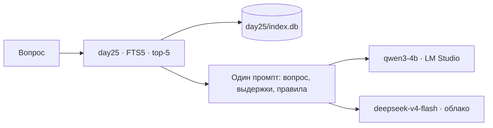
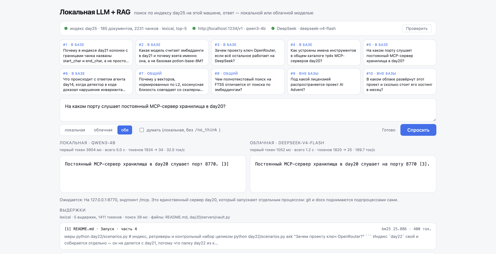

# day28 — RAG полностью на машине: индекс day25 и qwen3-4b, рядом DeepSeek для сравнения

Установка и общие команды запуска — в [корневом README](../README.md). Ключ DeepSeek нужен только облачной колонке; без него день работает целиком локально.

[`day25`](../day25/README.md) закончил неделю RAG: индекс в SQLite, лексический поиск, ответ с источниками — и каждый ответ уходил в DeepSeek по сети. [`day27`](../day27/README.md) показал, что `qwen3-4b` в LM Studio отвечает на этой машине и без ключей. Здесь две линии сходятся: поиск идёт по индексу day25, как и шёл, а генерацию делает локальная модель. Переключатель на странице ставит рядом DeepSeek — на том же контексте и том же промпте, — и разница между колонками становится разницей между моделями, а не между поисками.

| Условие задания | Где в коде |
| --- | --- |
| индекс из недели RAG | [search.py](search.py) читает `day25/index.db` кодом day25 — 185 документов, 2231 чанк, собран 2 октября |
| retrieval локально | лексика FTS5 в SQLite, top-5, около 30 мс на вопрос; ни одной модели до ответа |
| генерация локальной моделью | [llm.py](llm.py), провайдер `local`: `qwen3-4b` в LM Studio на `localhost:1234`, ключ-заглушка |
| выбор модели | переключатель «локальная / облачная / обе» на странице, `--models` у прогона |
| качество, скорость, стабильность | [scenarios.py](scenarios.py): контрольный набор day24 по три прогона на каждую модель |

## Главный вывод: локальный RAG работает, и платит за это временем, а не правильностью

На десяти контрольных вопросах, по три прогона на каждый, `qwen3-4b` нашла 0.59 обязательных фактов против 0.69 у `deepseek-v4-flash`, отказала на обоих вопросах «вне базы» все шесть раз из шести и ни разу не отказала там, где ответ был. Ни ошибки транспорта, ни обрыва по `max_tokens` за 60 ответов. Решение «ответить или отказаться» не разошлось между прогонами ни на одном вопросе ни у одной модели.

Разрыв в 0.10 — это два вопроса из десяти, и оба разобраны ниже: на одном локальная модель не донесла имя дословно, на другом пересказала выдержку своими словами там, где облачная повторила её точно. Цена же — в скорости: медианный ответ локальной модели занимает 7.9 секунды против 1.3 у облака, и почти всё это — не генерация, а чтение контекста.

## Поиск общий, и это условие сравнения

Поиск здесь — тот, что стоял под RAG в day22–day25: лексика FTS5 по `day25/index.db`, пять выдержек. Переписывание и LLM-реранкер day23, поднявшие recall@5 с 0.66 до 0.81, сюда не взяты сознательно: оба вызывают модель **до** ответа, и у локального режима этот вызов делала бы `qwen3-4b`, а у облачного — DeepSeek. Контекст у колонок стал бы разным, и сравнение моделей превратилось бы в сравнение поисков. Гибрид с вектором без вызова модели тоже не вариант: на 119 пробах day22 он дал 0.44 против 0.66 у лексики.

Поэтому обе модели получают одни и те же пять выдержек, в одном порядке, с одним промптом, и всё, что различается в таблицах, — заслуга или вина модели. Платой стала выдача: на вопросе #6 нужный абзац README day14 в пять выдержек не попал, и обе модели одинаково ответили «обрывается», не произнеся слово «полуслове», которое проверяет набор. Это потолок поиска, и он общий.



## Промпт один, и собран под слабую модель

Первая проба дня прошла с промптом day22 — правила, выдержки, вопрос последней строкой. DeepSeek ответил на вопрос про порт верно, а `qwen3-4b` выдала:

```
[1] В выдержках этого нет.
[2] В выдержках этого нет.
[3] В выдержках этого нет.
[4] В выдержках этого нет.
[5] В выдержках этого нет.
```

Ответ стоял в третьей выдержке. Модель совместила два правила — «помечай номером» и «если нет — напиши отказ» — и применила оба к каждой выдержке по отдельности, не отвечая на вопрос вовсе. Два прогона из двух, на вопросе про OpenRouter — просто `[1]`.

Стоило поставить вопрос первым, правила — после выдержек, а отказ — последним пунктом с оговоркой «только если», и та же модель на том же контексте ответила «Постоянный MCP-сервер хранилища в day20 слушает порт 8770. [3]» — и так же во втором прогоне. Облачной модели порядок частей безразличен, поэтому общий промпт собран так, как нужно 4B. Форма ответа — свободный текст с номерами в скобках, не json day24: у 4B структурированный ответ с цитатами рвётся чаще, чем выдерживается, а оборванный json сравнивать не с чем.

## Качество

`python day28/scenarios.py`, Apple M4, контекст у обеих моделей один:

| Модель | Факты найдены | Верных отказов «вне базы» | Ложных отказов | Ответов со ссылкой [n] | Оборвано по max_tokens | Ошибок |
| --- | --- | --- | --- | --- | --- | --- |
| `qwen3-4b` | 0.59 | **6 из 6** | **0 из 24** | 0.88 | 0 | 0 |
| `deepseek-v4-flash` | **0.69** | **6 из 6** | 3 из 24 | **1.00** | 0 | 0 |

По вопросам, три прогона через косую черту:

| # | Вид | Файлы в контексте | `qwen3-4b` | `deepseek-v4-flash` |
| --- | --- | --- | --- | --- |
| 1 | в базе | day21/README.md, day21/index.py | 1.00 / 1.00 / 0.50 | 1.00 / 1.00 / 1.00 |
| 2 | в базе | day21/embed.py, day21/README.md | 1.00 / 1.00 / 1.00 | 1.00 / 1.00 / 1.00 |
| 3 | в базе | README.md, day5/README.md | 0.25 / 0.50 / 0.50 | 1.00 / 1.00 / 1.00 |
| 4 | в базе | day20/README.md, day20/registry.py | 0.00 / 0.00 / 0.00 | 1.00 / 1.00 / 1.00 |
| 5 | в базе | README.md, day20/servers/vault.py | 1.00 / 1.00 / 1.00 | 1.00 / 1.00 / 1.00 |
| 6 | в базе | day14/agent.py, day14/README.md | 0.00 / 0.00 / 0.00 | 0.00 / 0.00 / 0.00 |
| 7 | общий | day21/embed.py, day21/README.md | 1.00 / 1.00 / 1.00 | отказ / отказ / отказ |
| 8 | общий | day21/README.md, day20/servers/docs.py | 0.50 / 0.50 / 0.50 | 0.50 / 0.50 / 0.50 |
| 9 | вне базы | README.md | отказ / отказ / отказ | отказ / отказ / отказ |
| 10 | вне базы | day14/seed.py, day15/seed.py | отказ / отказ / отказ | отказ / отказ / отказ |

На половине вопросов модели неразличимы: #2, #5, #6, #8, #9, #10 дали одинаковый счёт во всех прогонах. Разница сидит в трёх местах, и природа у неё разная.

**#4 — имя не доехало дословно.** Набор требует увидеть в ответе `docs__search`. DeepSeek приводит его: «`docs__search` разрешается как `qualified`». `qwen3-4b` все три раза объясняет схему — «имена формируются как `сервер__инструмент`, чтобы избежать коллизий» — верно по сути, но без единого примера, хотя примеры стоят в той же выдержке. Правило «названия приводи ровно так, как в выдержках» 4B читает как «не искажай», а не как «процитируй».

**#3 — пересказ вместо фактов.** Вопрос про ключ OpenRouter; в выдержке сказано: «нужен только в day5… DeepSeek отдаёт всего два уровня — flash и pro». DeepSeek повторяет это почти дословно и добирает имя слабой модели из пятой выдержки. `qwen3-4b` в первом прогоне пишет «нужен для доступа к слабой модели, которая используется в определённых шагах проекта, таких как генерация проб для сравнения» — `day5` потерян, `flash` и `pro` потеряны, а «генерация проб» склеена из соседней выдержки, где речь о ключе day21, причём о ключе DeepSeek, а не OpenRouter. Это единственный за 30 локальных ответов случай, когда факт из контекста приписан не тому, о чём спросили, — и он того рода, что выглядит правдоподобно.

**#7 — честность против полезности.** Вопрос общий: почему у нормированных векторов косинус равен скалярному произведению. В выдержках есть утверждение, но нет объяснения. DeepSeek все три раза отказывается — «В выдержках этого нет» — и по правилам промпта он прав. `qwen3-4b` все три раза отвечает — коротко и верно, но из собственной памяти, нарушая правило «только по выдержкам». Три «ложных отказа» облака в таблице — это весь #7, и назвать их ошибкой нельзя: модель сделала ровно то, о чём её просили. Локальная модель здесь полезнее для человека и хуже как инструмент, которому запретили додумывать.

Ещё одна мелочь, которой нет в таблице: в ответе на #8 `qwen3-4b` вставила английское «whereas» посреди русского предложения. Облачная модель так не делает. Для 4B смешение языков — известное свойство, и на RAG-ответах оно тоже всплывает.

## Скорость

| Модель | Первый токен, медиана | Всего, медиана | Токенов ответа, медиана | Ток/с, медиана |
| --- | --- | --- | --- | --- |
| `qwen3-4b` | 5.6 с | 7.9 с | 56 | 25.6 |
| `deepseek-v4-flash` | 1.0 с | 1.3 с | 58 | 245.9 |

Ответы одинаковой длины — около 57 токенов у обеих, — а времени локальная модель тратит в шесть раз больше. И тратит не на генерацию: 56 токенов при 25 ток/с — это две секунды, а до первого токена проходит пять с половиной. Остальное — чтение промпта. С пятью выдержками промпт весит около 2000 токенов, и на этой машине 4B переваривает их со скоростью 350–400 ток/с. В day27 первый токен приходил за 250–450 мс, потому что промпт был в тридцать строк; RAG увеличил его в семьдесят раз, и цена первого токена выросла вместе с ним.

Отсюда и разброс времени. Один и тот же вопрос, заданный подряд, во второй раз отвечается за 2.2 секунды вместо 7.9: LM Studio держит KV-кэш предыдущего промпта, и общий префикс не считается заново. В прогоне вопросы чередуются, кэш каждый раз сбрасывается, и в таблицу попадают «холодные» времена — именно они и есть честная цена RAG на локальной модели. У облака TTFT около секунды и не зависит от длины промпта заметным образом: 2000 токенов для него — не нагрузка.

Рассуждения выключены у обеих моделей по умолчанию: у Qwen3 маркером `/no_think`, у DeepSeek — `thinking: disabled`. Галочка на странице включает их у локальной модели, и прогон с `--think` показывает, что это стоит:

| `qwen3-4b` | Факты | Первый токен | Всего, медиана | Токенов ответа, медиана | Оборвано по max_tokens |
| --- | --- | --- | --- | --- | --- |
| `/no_think`, три прогона | 0.59 | 5.6 с | 7.9 с | 56 | 0 из 30 |
| с рассуждением, один прогон | 0.66 | 3.9 с | 19.7 с | 392 | 1 из 10 |

Рассуждение подняло факты на 0.07 — это #4, где модель, подумав, всё-таки привела `git__search` и `docs__search` примерами, — и стоило 2.5 раза по времени: медианный ответ 19.7 секунды, из 392 токенов ответа больше трёх четвертей — черновик. Первый токен приходит раньше, потому что это первый токен рассуждения, а не ответа; человек видит, как модель думает, но ответа ждёт дольше. И на #8 рассуждение упёрлось в `max_tokens`: 600 токенов ушли на размышление, ответ оборван на «[1» — единственный битый ответ дня, и он случился в режиме, который должен был улучшать. Один прогон — не замер стабильности, но направление то же, что в day27: там, где ответ лежит в выдержках, думать не нужно, а там, где не лежит, думать не помогает.

## Стабильность

| Модель | Разброс доли фактов | Разброс времени, доля от медианы | Вопросов, где решение разошлось |
| --- | --- | --- | --- |
| `qwen3-4b` | 0.09 | 0.73 | 0 из 10 |
| `deepseek-v4-flash` | **0.00** | 0.62 | 0 из 10 |

Разброс доли фактов — средний размах между тремя прогонами одного вопроса. У облака он нулевой: при температуре 0.2 DeepSeek на десяти вопросах дал десять раз по три одинаковых по сути ответа. У `qwen3-4b` два вопроса поплыли: #1 в третьем прогоне потерял половину фактов, #3 гулял от 0.25 до 0.50. На остальных восьми локальная модель так же воспроизводима, как облачная.

То, что важнее доли фактов, не поплыло вовсе: ни одна модель ни на одном вопросе не меняла решение «ответить или отказаться» между прогонами. Отказы на #9 и #10 — шесть из шести у обеих; отказ облака на #7 — три из трёх. Для RAG это главное свойство стабильности: ответ может быть сформулирован чуть иначе, но система не должна в одном прогоне отвечать, а в другом отказываться на том же контексте.

Разброс времени велик у обеих и объясняется разным. У локальной модели — длина выдержек, KV-кэш и загрузка машины: медианы по вопросам лежат от 4.6 до 11.1 секунды, а между прогонами одного вопроса размах в среднем 0.73 медианы. У облака — сеть и очередь на стороне провайдера: медианы 1.1–2.1 секунды, но в долях от медианы это те же 0.6. За 60 ответов не было ни одной ошибки транспорта, ни одного обрыва по `max_tokens` и ни одного битого ответа — у локальной модели это заслуга `/no_think`: без него, как показал day27, ответ на 600 токенов мог бы не поместиться вместе с рассуждениями.

## Веб-интерфейс



```bash
lms server start
uvicorn main:app --reload --app-dir day28
```

Плашка сверху проверяет три части системы отдельно: индекс day25 на диске, LM Studio с загруженной моделью и ключ DeepSeek в окружении. Красная точка у облака не мешает локальной колонке — в этом и состоит «полностью локально». Десять карточек — контрольный набор day24, клик задаёт вопрос сразу. Переключатель «локальная / облачная / обе» выбирает модель; «обе» шлёт два запроса параллельно, и колонки заполняются независимо, у каждой свои замеры под заголовком. Выдержки под колонками общие — они приходят первым кадром потока до единого токена модели, с путём, разделом и баллом bm25.

## Как устроено

| Файл | Назначение |
| --- | --- |
| `day28/search.py` | Поиск по `day25/index.db` кодом day25 через `sys.path`; индекс не создаёт, если его нет |
| `day28/llm.py` | Два провайдера за одним промптом: LM Studio и DeepSeek; стрим с замерами |
| `day28/questions.py` | Контрольный набор day24 без правок |
| `day28/main.py` | FastAPI: `/`, `GET /api/status`, `GET /api/questions`, `POST /api/ask` потоком |
| `day28/scenarios.py` | Прогон набора по моделям и повторам, команда `ask` для одного вопроса |
| `day28/static/` | Страница: статус, карточки вопросов, переключатель, две колонки, выдержки |

Модули day25 подключаются через `sys.path` на время импорта: у day28 нет своих `retrieve`, `index`, `embed`, `corpus` и `chunking`, перекрыть их нечем, а `llm` day25 не импортируется — иначе он занял бы имя `llm` этого дня. Базу адаптер не создаёт: `index.db()` в day25 выполняет `CREATE TABLE IF NOT EXISTS` при каждом открытии, и обращение к несуществующему файлу оставило бы после себя пустой индекс, похожий на собранный. Поэтому первым делом проверяется, что файл есть, и если нет — страница и прогон называют команду сборки.

## API

`POST /api/ask` принимает `{"question": "...", "provider": "local" | "cloud", "think": false}` и отдаёт `text/event-stream`: `event: context` с выдержками, `event: reasoning` с рассуждениями локальной модели, кадры `data: <json-строка>` с текстом ответа, затем `event: done` с `{provider, model, text, refused, finish_reason, ttft_ms, answer_ms, total_ms, prompt_tokens, completion_tokens, reasoning_tokens, tokens_per_sec}` либо `event: error`.

`GET /api/status` возвращает `{local: {online, base_url, model, models, model_available}, cloud: {configured, model}, index: {ready, documents, chunks, built_at, retriever, top_k}}`.

## Настройка

```
LMSTUDIO_BASE_URL=http://localhost:1234/v1
LMSTUDIO_MODEL=qwen3-4b
DEEPSEEK_API_KEY=...        # только для облачной колонки
DEEPSEEK_MODEL=deepseek-v4-flash
```

`LMSTUDIO_MODEL=qwen3-14b` переключает локальную колонку на старшую модель без правки кода — следующий шаг, если разрыв в 0.10 на фактах окажется важнее шести секунд на ответ.

## Известная мелочь

Как и в day26–day27, на Python 3.14 связка `openai` 3.6 и `httpcore2` печатает в stderr `RuntimeError: generator didn't stop after athrow()` при закрытии стрима. На ответы это не влияет; markdown прогона идёт в stdout, и `python day28/scenarios.py > report.md` даёт чистый файл.
