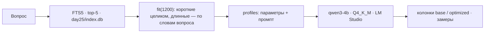
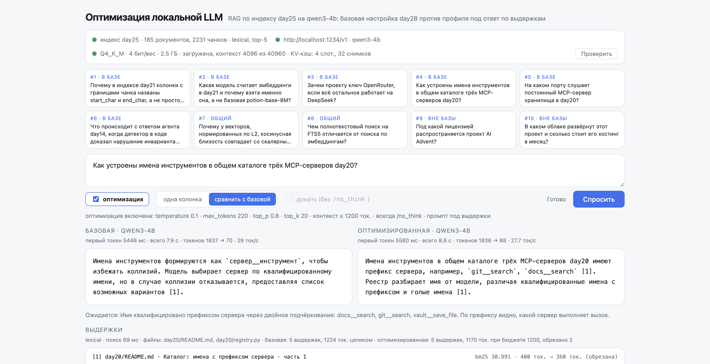

# day29 — qwen3-4b под задачу «ответ по выдержкам»: два профиля одной модели и чекбокс между ними

Установка и общие команды запуска — в [корневом README](../README.md). Ключей день не читает: обе колонки на странице локальные.

[`day28`](../day28/README.md) поставил локальную `qwen3-4b` под RAG по индексу day25 и измерил её против DeepSeek: 0.59 обязательных фактов против 0.69, 7.9 секунды на ответ против 1.3, и почти всё это время — чтение промпта. Настройки модели там были взяты с запасом и для обеих сторон одинаковыми, потому что сравнивались модели. Здесь сравниваются настройки. Модель одна, поиск один, вопросы те же, а чекбокс «оптимизация» переключает `qwen3-4b` между настройкой day28 и профилем, собранным под эту задачу: другая температура и отсечение, потолок ответа, бюджет контекста, промпт. Квантование не менялось — на диске один `Q4_K_M`, и это видно в статусе; контекстное окно задаётся при загрузке модели через REST LM Studio.

| Условие задания | Где в коде |
| --- | --- |
| параметры: temperature, max tokens | [profiles.py](profiles.py): `BASE` 0.2 / 600, `OPTIMIZED` 0.1 / 220 плюс `top_p 0.8`, `top_k 20` |
| context window | в два слоя: бюджет выдержек в промпте — `Context.fit` в [search.py](search.py); окно модели при загрузке — `load` в [lmstudio.py](lmstudio.py), команда `scenarios.py load --context` |
| квантование | модель `Q4_K_M`, 4 бита на вес, 2.5 ГБ — статус страницы читает это из `GET /api/v1/models`; других квантов не скачивалось |
| prompt-шаблон под кейс | `OPTIMIZED_SYSTEM`, `OPTIMIZED_RULES` в [profiles.py](profiles.py): правило о дословном цитировании имён и чисел, пример формы ответа, всегда `/no_think` |
| чекбокс включения/выключения | страница: `optimized: true/false` в `POST /api/ask`, `profiles.for_flag` в [main.py](main.py) |

## Главный вывод: промпт и бюджет контекста дали +0.21 фактов и нулевой разброс, а времени почти не сэкономили

`python day29/scenarios.py`, десять контрольных вопросов day24 по три прогона на профиль, профили чередуются на каждом вопросе, модель перезагружена перед прогоном:

| Профиль | Факты найдены | Верных отказов «вне базы» | Ложных отказов | Ответов со ссылкой [n] | Ответов с английскими словами | Оборвано по max_tokens | Ошибок |
| --- | --- | --- | --- | --- | --- | --- | --- |
| `base` | 0.59 | **6 из 6** | **0 из 24** | 0.88 | 3 из 24 | 0 | 0 |
| `optimized` | **0.80** | **6 из 6** | **0 из 24** | **1.00** | 2 из 24 | 0 | 0 |

Базовый профиль воспроизвёл day28 до сотой — 0.59, — и это важно: значит, разница ниже не шум прогона, а разница настроек. Оптимизированный профиль нашёл 0.80 обязательных фактов: больше, чем `deepseek-v4-flash` в day28 (0.69), на том же контексте и той же модели. Ни один отказ не поплыл, каждый ответ со ссылкой на выдержку, ни одного обрыва по `max_tokens` при потолке в 220 вместо 600.

Цена этой прибавки — не время, а честность о времени. Промпт стал короче на 14 %, первый токен на холодной модели пришёл на 0.8 секунды раньше, и это всё, что бюджет контекста дал скорости. Что дало много — кэш промптов LM Studio, и он одинаково помогает обоим профилям.

## Что в оптимизированном профиле и откуда это взялось

Каждый пункт профиля — ответ на конкретное место, где `qwen3-4b` в day28 ошибалась или тратила лишнее.

**Промпт.** Три вопроса из десяти в day28 были проиграны не поиском, а формой ответа. На #4 модель объясняла схему имён — «`сервер__инструмент`, чтобы избежать коллизий» — верно, но без единого примера, хотя `docs__search` и `git__search` стояли в той же выдержке; набор требует увидеть имя. На #3 модель пересказывала выдержку своими словами и теряла по дороге `day5`, `flash` и `pro`. Правило «приводи ровно так, как в выдержках» 4B читала как «не искажай», а не как «процитируй». В оптимизированном промпте оно переписано: «числа, порты, имена файлов, моделей и инструментов приводи сами, дословно, — не описывай их словами», и перед правилами стоит пример формы ответа с выдуманными именами и портом. Результат: #4 — 1.00 во всех трёх прогонах вместо 0.00, #3 — 1.00 / 0.75 / 1.00 вместо 0.50 / 0.25 / 0.50. Порядок частей — вопрос, выдержки, правила, вопрос ещё раз — у обоих профилей один: в day28 именно он заставил модель отвечать по делу вместо «[1] В выдержках этого нет.» на каждую выдержку, и оптимизация его не трогает.

**Параметры.** Температура 0.1 вместо 0.2 и отсечение `top_p 0.8`, `top_k 20` — значения, которые Qwen рекомендует для режима без рассуждений; для задачи «извлеки факт из текста» нужен не выбор из многих продолжений, а самое вероятное. Это видно в стабильности: разброс доли фактов между прогонами одного вопроса упал с 0.09 до 0.03; базовый профиль плавал на #1 и #3, оптимизированный — только на #3, и то на четверть.

**Потолок ответа.** Медианный ответ в day28 — 56 токенов, а потолок стоял 600, потому что те же 600 нужны были рассуждениям. Рассуждение в оптимизированном профиле выключено всегда — в day27 и day28 оно стоило в 2.5 раза по времени и прибавляло фактов на одном вопросе из десяти, — и потолок опущен до 220: три предложения с номерами помещаются с запасом, а генерация, сорвавшаяся в болтовню, оборвётся втрое раньше. За 30 ответов обрывов не было.

**Бюджет контекста.** Пять выдержек day25 весят от 1164 до 1750 токенов индекса, около 1900 токенов Qwen вместе с правилами. Оптимизированный профиль укладывает их в 1200: потолок делится между выдержками так, чтобы короткие остались целыми, а резались только длинные. Первая версия резала длинные с хвоста — и на вопросе #1 потеряла ответ все три раза: фраза про ключевое слово `end` и выражение `CASE` стоит в последних ста символах выдержки на 1175. Поэтому длинные выдержки режутся не с хвоста, а по смыслу: текст делится на предложения (у кода — на строки), каждое получает балл по числу слов вопроса в нём, остаются самые полезные в исходном порядке, пропуски помечаются «…». Проверка без модели — есть ли обязательные факты в ужатом контексте — показала, что при бюджете 1200 на месте все факты всех восьми вопросов, где они вообще были в выдаче; при 1000 теряется порт `8770` из #5, потому что он стоит в строке кода `PORT = 8770`, где нет ни одного слова вопроса. 1200 — нижняя граница, на которой этот способ ничего не теряет на контрольном наборе.



## Что промптом не лечится

В day28 `qwen3-4b` вставила английское «whereas» посреди русского ответа на #8. Прогон этого дня считает такие слова отдельной колонкой — латиница вне кода и вне имён из выдержек, — и у обоих профилей их 2–3 из 24: то же «whereas» на том же месте и «эмbedding» с латинской серединой на #2. Запрет на латиницу проверен тремя формулировками: строкой в системном промпте, отдельным правилом с перечислением «whereas, however, while», фразой «английские союзы недопустимы». Ни одна не подействовала — при температуре 0.1 это самое вероятное продолжение модели, и инструкция его не перевешивает. В итоговом профиле запрета нет: это лишние токены без эффекта. Лечить это можно только на уровне декодирования — штрафом на конкретные токены, которого OpenAI-совместимый API LM Studio не даёт, — или другой моделью.

## Скорость: кэш промптов важнее любого параметра

| Профиль | Токенов промпта, медиана | Первый токен, прогон 1 | Первый токен, повторы | Всего, медиана | Токенов ответа, медиана | Ток/с, медиана |
| --- | --- | --- | --- | --- | --- | --- |
| `base` | 1938 | 5.5 с | 1.5 с | 3.7 с | 56 | 33.1 |
| `optimized` | 1674 | 4.7 с | 1.4 с | 4.4 с | 62 | 33.3 |

Первый прогон идёт сразу после перезагрузки модели — промпты для неё новые, и цена чтения видна целиком: 5.5 секунды на 1938 токенов у базового профиля, 4.7 на 1674 у оптимизированного, то есть те же 350–370 токенов в секунду, что в day28. Бюджет сэкономил 14 % промпта и столько же времени до первого токена. Во втором и третьем прогонах те же вопросы отвечаются с первым токеном за полторы секунды, а повторённый подряд вопрос — за 200–400 мс: LM Studio хранит кэш уже виденных промптов, и он переживает смену вопроса, перезапуск скрипта и даже загрузку с `parallel 1` и `context_checkpoints 0` — сбрасывает его только перезагрузка модели. Поэтому в таблице два столбца, а не один: медиана по трём прогонам смешала бы холодный с тёплыми и показала бы 2–3 секунды, которых не существует ни в одном реальном сценарии.

Это же объясняет, почему медиана «всего» у оптимизированного профиля выше при более коротком промпте: его ответы на 6 токенов длиннее — он называет имена и порты, которые базовый опускал, — а при 33 токенах в секунду это 0.2 секунды, которые на тёплых прогонах заметнее сэкономленных на чтении.

## Контекстное окно: 4096 против 40960

Окно модели задаётся при загрузке и из запроса не меняется, поэтому оно не часть профиля, а команда: `python day29/scenarios.py load --context N` выгружает экземпляры `qwen3-4b` через `POST /api/v1/models/unload` и поднимает новый через `POST /api/v1/models/load` с нужным `context_length`. Без выгрузки LM Studio не меняет окно, а ставит рядом второй экземпляр `qwen3-4b:2`, и запросы по имени модели продолжают идти в первый — это пришлось проверить, прежде чем писать `load`.

| Окно при загрузке | Загрузка | Первый токен, холодный, `base` | Первый токен, холодный, `optimized` | Ток/с |
| --- | --- | --- | --- | --- |
| 4096 | 0.8–1.1 с | 5.5 с | 4.7 с | 33 |
| 40960 (максимум модели) | 1.9 с | 5.8 с | 5.0 с | 31–32 |

Строка 40960 — один холодный прогон после перезагрузки с одним слотом, строка 4096 — первый прогон основной таблицы; условия близкие, но не одинаковые, поэтому разница в 0.3 секунды — направление, а не замер. Промпт в 1900 токенов и ответ в 220 помещаются в 4096 с запасом, большое окно для этой задачи только резервирует память под KV-кэш, которой задача не пользуется. Оптимизация здесь — не выбрать окно побольше, а не выбирать его: 4096 и есть рабочее значение, оно показано в статусе страницы и в шапке каждого отчёта.

## Квантование

На машине один вариант `qwen3-4b` — `Q4_K_M`, 4 бита на вес, 2.5 ГБ против примерно 8 ГБ в `bf16`. Это и есть квантование; статус страницы читает его из `/api/v1/models` вместе с размером и максимальным окном, и то же пишется в шапку отчёта. Второй квант — `Q8_0` на 4.3 ГБ или `Q3_K_M` на 2 ГБ — скачивать не стали: сравнение квантов меняет модель, а день про то, что можно сделать с той, что есть. Косвенно о цене четырёх бит говорит раздел выше: смешение алфавитов внутри слова — «эмbedding» — характерный след грубого кванта у маленькой модели, и промптом он не снимается.

## Веб-интерфейс



```bash
lms server start
uvicorn main:app --reload --app-dir day29
```

Плашка сверху — три проверки: индекс day25 на диске, LM Studio с моделью в списке, и сама модель — квантование, размер, загружена ли, с каким окном и каким кэшем. Чекбокс «оптимизация» включён по умолчанию; строка под формой расшифровывает активный профиль. Режим «сравнить с базовой» показывает две колонки, и запросы в них идут по очереди, а не параллельно, как «обе» в day28: там колонки шли к разным серверам, здесь — к одной модели на одной машине, и два одновременных запроса делили бы GPU, а замеры показывали бы соседа. Галочка «думать» доступна только базовому профилю: оптимизированный всегда добавляет `/no_think`. Выдержки под колонками общие по поиску, но у каждой стоит, сколько токенов от неё получила оптимизированная колонка и была ли она ужата.

## Как устроено

| Файл | Назначение |
| --- | --- |
| `day29/profiles.py` | Два профиля: параметры генерации, потолок ответа, бюджет контекста, промпт; `for_flag(optimized)` |
| `day29/search.py` | Поиск по `day25/index.db` кодом day25 плюс `Context.fit` и `Source.squeeze` — укладка в бюджет по словам вопроса |
| `day29/lmstudio.py` | REST LM Studio: квантование, загруженные экземпляры и их окно, `load` с `context_length` |
| `day29/llm.py` | Один клиент LM Studio; исполняет профиль и считает замеры |
| `day29/main.py` | FastAPI: `/`, `GET /api/status`, `GET /api/questions`, `POST /api/ask` потоком |
| `day29/scenarios.py` | Прогон по профилям с чередованием, `ask` одного вопроса, `load` модели с окном |
| `day29/questions.py` | Контрольный набор day24 без правок |
| `day29/static/` | Страница: статус, карточки, чекбокс, режим сравнения, две колонки, выдержки |

## API

`POST /api/ask` принимает `{"question": "...", "optimized": true, "think": false}` и отдаёт `text/event-stream`: `event: context` с выдержками, которые читала модель — для оптимизированного профиля с полями `budget`, `trimmed`, `dropped` и пометкой `trimmed` у каждой ужатой выдержки, — `event: reasoning`, кадры `data` с текстом, `event: done` с `{profile, model, text, refused, finish_reason, ttft_ms, answer_ms, total_ms, prompt_tokens, completion_tokens, reasoning_tokens, tokens_per_sec}` либо `event: error`.

`GET /api/status` возвращает `{local: {online, base_url, model, models, model_available, info: {quantization, bits_per_weight, size_gb, max_context_length, loaded, loaded_context_length, parallel, context_checkpoints}}, index: {...}, profiles: {base: {...}, optimized: {...}}}`.

## Настройка

```
LMSTUDIO_BASE_URL=http://localhost:1234/v1
LMSTUDIO_MODEL=qwen3-4b
```

`LMSTUDIO_MODEL=qwen3-14b` переключает оба профиля на старшую модель; `load --context` работает с той моделью, что задана. Замеры дня — Apple M4, LM Studio с окном 4096, `parallel 4`, `context_checkpoints 32`.

## Известная мелочь

Как и в day26–day28, на Python 3.14 связка `openai` 3.6 и `httpcore2` печатает в stderr `RuntimeError: generator didn't stop after athrow()` при закрытии стрима. На ответы это не влияет; markdown прогона идёт в stdout, и `python day29/scenarios.py > report.md` даёт чистый файл.
