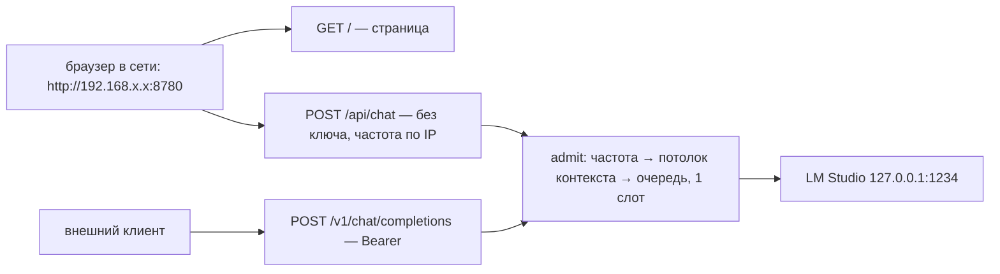
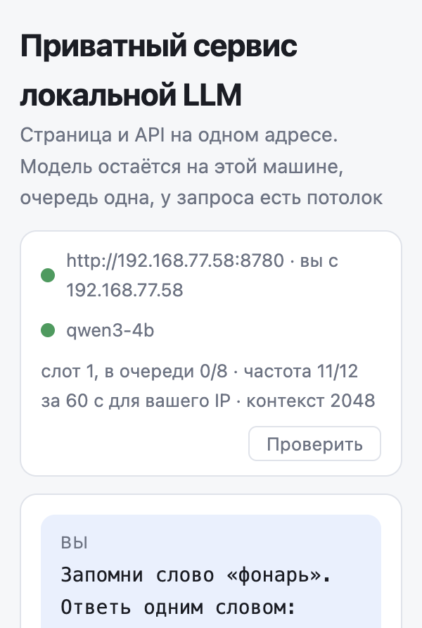

# day30 — qwen3-4b как сервис в локальной сети: один адрес, страница чата и API, очередь в один слот, потолки частоты и контекста

Установка и общие команды запуска — в [корневом README](../README.md). Облачных ключей день не читает. Модель та же, что в [day26](../day26/README.md)–[day29](../day29/README.md): `qwen3-4b` в LM Studio на `127.0.0.1:1234`. Этот порт наружу не открывается. Наружу смотрит один процесс — `server.py` на порту `8780`: в браузере вводят `http://<ip-машины>:8780`, получают страницу чата, и она ходит на тот же адрес. Внешним клиентам на том же порту — OpenAI-совместимый `/v1` под ключом.

«Домашний сервер или VPS» здесь — тот же `server.py` с `SERVICE_HOST=0.0.0.0`. С ключом `day30-local` в сеть процесс не выйдет: слушать не-loopback с ключом по умолчанию он отказывается, свой задаётся `SERVICE_API_KEY`. Ключ закрывает только `/v1`; страница в локальной сети открыта без ключа — так выбрано сознательно, граница приватности здесь сеть, а не пароль. Отдельная машина в репозитории не поднимается.

| Условие задания | Где в коде |
| --- | --- |
| HTTP API | [server.py](server.py): `GET /health`, `GET /v1/models`, `POST /v1/chat/completions` — обычный ответ и стрим |
| чат | тот же `server.py`: `GET /` отдаёт [static/](static/), `POST /api/chat` стримит ответ странице |
| доступ по сети | один порт на всё; LM Studio остаётся на localhost. При старте печатаются адреса этой машины в сети |
| несколько запросов не ломают модель | [limits.py](limits.py) `SlotQueue`: один слот, восемь ждущих, девятый — `503` |
| rate limit | `RateLimiter`: 12 запросов за 60 секунд — на ключ для `/v1`, на IP для страницы; `429` и `Retry-After` |
| max context | `trim`: бюджет `max_context - max_tokens`, старые ходы снимаются, слишком длинная реплика режется с начала |



Оба входа идут через одну функцию `admit`: частота по идентификатору клиента, обрезка, слот. Отклонённый по частоте запрос слот не занимает. Диалог на диск не пишется: шлюз забывает сообщения сразу после ответа, история живёт только в странице.

## Живой прогон: десять запросов сразу, длинная история, затем 429

`python day30/scenarios.py burst`, сервис поднят на `0.0.0.0` со своим ключом, модель уже тёплая, `max_tokens` коротких запросов — 8. Сначала без ключа: `GET /` отдал HTML, `POST /api/chat` ответил потоком с кадрами `meta` и `done`. Потом десять запросов к `/v1` одновременно: слот один, глубина ожидания восемь, десятому места нет.

| # | статус | очередь, мс | всего, мс |
| --- | --- | --- | --- |
| 1 | 200 | 0 | 555 |
| 2 | 200 | 502 | 882 |
| 3 | 200 | 830 | 1212 |
| 4 | 200 | 1158 | 1604 |
| 5 | 200 | 1547 | 1983 |
| 6 | 200 | 1924 | 2287 |
| 7 | 200 | 2236 | 2562 |
| 8 | 200 | 2511 | 2857 |
| 9 | 200 | 2803 | 3168 |
| 10 | 503 | — | 51 |

Стена заняла 3.2 секунды. Девять ответов 200, один 503 за 51 миллисекунду — он не стоял в очереди. Ожидание выросло от 0 до 2803 мс: запросы прошли по одному, а не делили GPU. Это прямой вывод day29, где два одновременных запроса к одной модели мерили бы друг друга, а не себя.

Дальше история на 34053 токена оценки `cl100k_base` — сорок ходов с повтором одной фразы. Сервис снял 38 сообщений. Оценка оставшегося промпта — 1734 при бюджете 2032 (потолок 2048 минус 16 токенов ответа этого запроса). Модель насчитала `prompt_tokens` 1494: оценка cl100k для этого текста выше, чем токенизатор Qwen, поэтому обрезка срабатывает раньше, чем модель упёрлась бы в окно. Оба числа ниже потолка 2048.

Окно частоты ключа к этому моменту почти потрачено: десять запросов пачки (включая тот, что получил 503 — частота проверяется до очереди), плюс длинная история. Следующий короткий запрос прошёл, ещё один получил `429` и `Retry-After: 53`. Отказ пришёл без генерации. Запрос страницы в начале прогона этого окна не тронул: у него своё, по IP.

`python day30/scenarios.py limits` то же самое без модели и без сети: короткая история не режется, длинная теряет старые ходы и бережёт системное сообщение и хвост последней реплики, одна гигантская реплика укорачивается с начала, запас на ответ отнимает место у промпта, окно частоты закрывается и открывается по подставленным часам, третий за глубиной очереди получает отказ, `0.0.0.0` с ключом `day30-local` запрещён.

## Веб-интерфейс



```bash
lms server start
python day30/server.py
```

Один процесс. Он печатает адреса, которые можно ввести в браузере: `http://127.0.0.1:8780` всегда, а при `SERVICE_HOST=0.0.0.0` — ещё адреса этой машины в сети, самые вероятные первыми. Адреса берутся из списка интерфейсов, а не из маршрута по умолчанию: при включённом VPN маршрут уводит в туннель, и подсказка показала бы адрес, по которому с соседнего устройства не достучаться.

Плашка — адрес, с которого открыта страница, и IP, с которого пришёл браузер; модель; лимиты: слот, сколько ждут, остаток частоты для этого IP, потолок контекста. Если ключ API всё ещё `day30-local`, плашка так и пишет: только localhost. Лента — обычный чат. Под ответом строка шлюза: ожидание в очереди, сколько ходов срезано, оценка контекста, токены модели, время до первого токена, остаток частоты. Галочка «думать» по умолчанию выключена: к уходящей реплике дописывается `/no_think`, в ленту маркер не попадает. «Начать заново» стирает переписку в странице; на сервисе стирать нечего.

Ключа страница не знает и не просит: `/api/chat` открыт для тех, кто дошёл до адреса. Отказы по частоте и очереди она получает тем же потоком, кадром `error`.

## По сети

```bash
SERVICE_HOST=0.0.0.0 SERVICE_API_KEY=своё-длинное-слово python day30/server.py
```

На другом устройстве в той же сети — `http://<ip-машины>:8780`, адрес из лога старта. Порт `1234` в файрволе не открывать: LM Studio наружу не нужен, к нему ходит только шлюз. Внешним клиентам `/v1` на том же порту, с заголовком `Authorization: Bearer <ключ>`.

На этой машине страница по `http://192.168.77.58:8780` показала: `вы с 192.168.77.58`, частота `11/12 для вашего IP` после первого хода, второй ход вспомнил слово из первого. `/v1/models` по тому же адресу без ключа — `401`, с ключом — `200`.

## Как устроено

| Файл | Назначение |
| --- | --- |
| `day30/server.py` | Один процесс: страница, `/api/chat` и `/api/status` без ключа, `/v1` под ключом, общий `admit`, прокси в LM Studio, адреса в сети |
| `day30/limits.py` | Оценка токенов, `trim`, скользящее окно, очередь слотов — без сети |
| `day30/config.py` | Адрес, ключ, потолки; отказ слушать сеть с ключом по умолчанию |
| `day30/scenarios.py` | `limits` без модели, `burst` по живому сервису |
| `day30/static/` | Плашка, лента, строка лимитов под ответом |

## API

`POST /v1/chat/completions` принимает тело в форме OpenAI (`messages`, `stream`, `max_tokens`, `temperature`) и заголовок `Authorization: Bearer`. Ответ — обычный JSON или `text/event-stream` с кадрами `chat.completion.chunk` и завершением `data: [DONE]`.

Заголовки ответа:

- `X-Queue-Wait-Ms` — сколько запрос простоял в очереди
- `X-Context-Dropped` — сколько сообщений снято целиком
- `X-Context-Truncated` — `1`, если у оставшейся реплики отрезали начало
- `X-Context-Tokens` — оценка промпта после обрезки
- `X-RateLimit-Remaining`, `X-RateLimit-Limit`
- `Retry-After` — только на `429`

`GET /health` без ключа: жив ли шлюз, жив ли LM Studio, какие стоят потолки. `GET /v1/models` с ключом отдаёт список LM Studio и остаток частоты, но сам попытку не тратит. Частота и очередь считаются только на `POST /v1/chat/completions` и `POST /api/chat`: опрос плашки не съедает окно.

Для страницы — `GET /api/status` и `POST /api/chat` без ключа, с частотой по IP. Ответ `/api/chat` — `text/event-stream` с кадрами `meta` (то же, что в заголовках выше), `reasoning`, `data`, `done` либо `error`.

Без ключа и с чужим ключом на `/v1` — `401`. Очередь заполнена — `503`. LM Studio молчит — `502`.

## Настройка

```
LMSTUDIO_BASE_URL=http://127.0.0.1:1234/v1
LMSTUDIO_MODEL=qwen3-4b
SERVICE_HOST=127.0.0.1
SERVICE_PORT=8780
SERVICE_BASE_URL=http://127.0.0.1:8780
SERVICE_API_KEY=day30-local
SERVICE_SLOTS=1
SERVICE_QUEUE=8
SERVICE_RATE_LIMIT=12
SERVICE_RATE_WINDOW=60
SERVICE_MAX_CONTEXT=2048
SERVICE_MAX_TOKENS=512
```

`SERVICE_BASE_URL` нужен только `scenarios.py burst`: страница в нём не нуждается, она ходит на адрес, с которого открыта.

Оценка токенов — `cl100k_base`, как в day8: своего токенизатора Qwen библиотека не отдаёт. Точное число приходит в `usage` и видно в строке под ответом.
