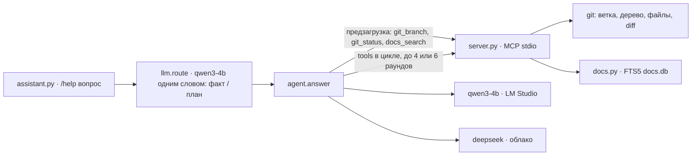

# day31 — ассистент разработчика: `/help` по документации и состоянию репозитория, две модели и маршрут между ними

Установка и общие команды запуска — в [корневом README](../README.md). Веба нет: ассистент живёт в терминале. Локальная модель та же, что в [day26](../day26/README.md)–[day30](../day30/README.md), — `qwen3-4b` в LM Studio; облачная — DeepSeek, как в [day16](../day16/README.md)–[day25](../day25/README.md). Ключ нужен только вопросам про план и устройство; без него всё остаётся на машине.

Две линии проекта здесь впервые работают на один ответ. RAG недели [day21](../day21/README.md)–[day25](../day25/README.md) даёт ассистенту документацию, MCP недели [day16](../day16/README.md)–[day20](../day20/README.md) — сам репозиторий: ветку, состояние дерева, файлы, diff. Команда `/help` собирает и то и другое в один промпт, а дальше модель вправе позвать инструменты сама.

| Условие задания | Где в коде |
| --- | --- |
| README и docs в RAG | [docs.py](docs.py): корневой `README.md` и `README.md`/`TASK.md` каждого дня — 63 файла, 369 разделов — в FTS5 `docs.db`; папки `docs/` в репозитории нет, документация лежит по дням |
| MCP: git-ветка | [server.py](server.py), `git_branch`: ветка, upstream, впереди/позади, последний коммит; вызывается кодом перед каждым ответом |
| MCP: файлы и diff | там же: `git_status`, `git_files`, `git_diff` — новые файлы в diff показываются целиком, патч режется по бюджету |
| `/help` отвечает о проекте | [assistant.py](assistant.py) разбирает команду, [agent.py](agent.py) ведёт ход: предзагрузка через MCP → промпт → цикл с инструментами |
| документация и контекст вместе | системное сообщение несёт ветку и дерево, пользовательское — вопрос и пять разделов; остальное модель берёт инструментами |

## Главное решение: контекст приходит двумя путями

Задание можно было закрыть чистым агентом в духе day17: все инструменты модели, она сама решает, что позвать. На `qwen3-4b` это не работает — модель регулярно отвечает без единого вызова, то есть вовсе без контекста. Можно было, наоборот, собрать всё кодом и сделать один вызов без инструментов — тогда облачная модель не смогла бы копнуть глубже вопроса: попросить diff, перечитать раздел, поискать другими словами.

Поэтому путей два, и оба идут через одну сессию MCP, открытую на весь диалог:

- **Предзагрузка** — до первого токена модели код зовёт `git_branch`, `git_status` и `docs_search(вопрос, 5)`. Это гарантированный минимум: даже если модель не позовёт ничего, она отвечает, зная ветку, состояние дерева и пять ближайших разделов документации.
- **Инструменты** — те же шесть функций сервера уезжают в `tools` запроса. Модель зовёт `git_diff`, `git_files`, `docs_read`, ещё один `docs_search` — и всё это видно в ленте строками `⚙`.



Разделы, найденные по ходу вторым поиском, нумеруются продолжением — [6], [7] — чтобы ссылка в ответе указывала на один источник, а не на «первый из второго поиска». В расшифровке ниже это видно: облачная модель сослалась на `[6] day31/TASK.md`, которого в предзагрузке не было.

## Две модели и кто между ними выбирает

Конкретный вопрос — «на каком порту», «как называются инструменты», «какая ветка» — закрывается выдержками, и 4B-модель на этой машине отвечает на него не хуже облака ([day28](../day28/README.md) это измерил), только офлайн и бесплатно. Вопрос про проектирование, сравнение или план требует держать несколько дней проекта сразу и звать инструменты по ходу — здесь слабая модель теряется, и такие вопросы уходят в DeepSeek.

Решает сама локальная модель, одним вызовом без рассуждений: ответ — слово `факт` или `план`, 0.6–1 секунда на тёплой модели. Маршрут печатается первой строкой ответа, и его можно перекрыть флагом `--local` или `--cloud` в конце вопроса. Фолбэки честные: LM Studio молчит — всё в облако, ключа нет — всё локально, и причина пишется вместо маршрута.

| Вопрос | Маршрут |
| --- | --- |
| На каком порту слушает хранилище day20? | факт → `qwen3-4b` |
| Какая сейчас ветка? | факт → `qwen3-4b` |
| Как лучше спроектировать day32 с планировщиком поверх MCP day18? | план → `deepseek-v4-flash` |
| Почему в day25 из корпуса выброшены четыре папки, и стоит ли так делать дальше? | план → `deepseek-v4-flash` |

## Что пришлось подкрутить под слабую модель

Три правки, все в [agent.py](agent.py), и каждая — ответ на конкретный сбой `qwen3-4b`.

Первая проба с полным каталогом инструментов дала на вопросе про порт ответ `[1]` — восемь токенов, ни числа, ни предложения. Та же модель без `tools` на том же промпте отвечала `8770 [2]`. Виноват объём: шесть схем с полными описаниями — около 1400 токенов, и 4B-модель на них «залипала». Локальной модели каталог теперь уходит с описаниями в одну строку и без `title` у полей — на 600 токенов меньше; облачной — полный.

Правила ответа переехали из системного сообщения в пользовательское, после выдержек, — это компоновка day28: вопрос, выдержки, правила, вопрос ещё раз. С правилами в системном сообщении модель на части вопросов всё равно отвечала одной строкой `[3]`; с правилами под выдержками, где первое из них — «отвечай связным текстом, номер — дополнение к предложению, а не ответ», — отвечает предложениями на всех проверенных вопросах.

Тема последнего коммита из строки состояния убрана. С «Add day30 with a LAN service…» в системном сообщении модель приписывала LAN-сервис новым файлам day31, и оговорка «это уже закоммичено, о текущих файлах не говорит» не помогла. Модели остаются хеш и дата; тема лежит в payload `git_branch`, и человек видит её в строке `→ проект`.

## Живой прогон

Всё ниже — вывод `python day31/assistant.py "/help …"`, тёплая модель, дерево с незакоммиченными файлами этого дня.

Конкретный факт, локально:

```
→ модель: qwen3-4b · локальная · LM Studio — вопрос про конкретный факт (5.5 с)
→ проект: ветка main (upstream origin/main, синхронизирована); последний коммит bf5b78f «Add day30 with a LAN service…» от 2026-10-12; в рабочем дереве новых 8: day31/README.md, day31/TASK.md, day31/agent.py, …
→ документация: 5 разделов (все слова) · в индексе файлов: 61, разделов: 357

Постоянный MCP-сервер хранилища в day20 слушает на порту 8770 [2].

Источники:
  [1] day24/README.md — «Прогон из терминала»
  [2] day23/README.md — «Прогон из терминала»
  …
— qwen3-4b · раундов 1 · вызовов 0 · первый токен 13.2 с · всего 14.5 с · токены 3571 → 34
```

Вопрос про структуру, локально:

```
→ модель: qwen3-4b · локальная · LM Studio — вопрос про конкретный факт (3.4 с)

Имена инструментов в реестре day20 формируются как `сервер__инструмент`, где `сервер` — это имя сервера, а `инструмент` — название функции. Префикс сервера нужен, чтобы избежать коллизий при совпадении имен инструментов между разными серверами. Например, инструмент `search` используется как `git__search` и `docs__search`, что позволяет различить их владельцев.

Источники:
  [1] day20/README.md — «Каталог: имена с префиксом сервера»
  [2] day20/README.md — «Интерфейс»
  [3] day20/README.md — «Три сервера, три роли, два транспорта»
  …
— qwen3-4b · раундов 1 · вызовов 0 · первый токен 10.5 с · всего 14.8 с · токены 3324 → 117
```

Вопрос про дерево, локально — модель позвала инструменты сама:

```
→ модель: qwen3-4b · локальная · LM Studio — вопрос про конкретный факт (5.5 с)

  ⚙ git_branch() · 470 мс
  ⚙ git_status() · 92 мс
Текущая ветка — main. В рабочем дереве есть 6 неотслеживаемых файлов в day31: agent.py, assistant.py, docs.db, docs.py, llm.py, server.py. [1]
— qwen3-4b · раундов 2 · вызовов 2 · первый токен 20.1 с · всего 23.8 с · токены 3239 → 97
```

План, в облаке:

```
→ модель: deepseek-v4-flash · облачная · DeepSeek — вопрос про план или устройство (3.6 с)
→ документация: 5 разделов (любое слово) · в индексе файлов: 61, разделов: 357

Спроектировал бы day32 как отдельный MCP-сервер на streamable HTTP (по образцу `http://127.0.0.1:8765/mcp`), где фоновый цикл в `lifespan` раз в период снимает состояние репозитория и складывает снимки в SQLite, а затем сводит их в агрегат [1][3]. Инструменты MCP — `collect` (сбор фактов о коде и документации), `summary` (свод расхождений) и `schedule_job` для смены расписания словами, а не в коде [1][2]. Расхождения искал бы, сопоставляя разделы README/TASK с фактическими файлами и путями, а результат отдавал агрегированно, как требует TASK [2]. Веб-слой — по образцу day18: наблюдатель раз в 15 с забирает новые сводки, пересказывает моделью в `feed.json` и SSE `/api/feed`, плюс `/api/ask` с тем же набором инструментов [3][4].

Источники:
  [1] day18/README.md — «вступление»
  [2] day18/TASK.md — «вступление»
  [3] day18/README.md — «Почему сервер постоянный, а не stdio»
  [4] day18/README.md — «API»
  [5] day18/README.md — «Файлы»
— deepseek-v4-flash · раундов 1 · вызовов 0 · первый токен 3.6 с · всего 5.0 с · токены 3058 → 259
```

## Где локальная модель останавливается

Один и тот же вопрос — «Что нового в рабочем дереве и что делает каждый новый файл?» — классификатор отнёс к фактам, и это спорно: ответить на него можно только прочитав diff. Локальная модель позвала `git_status`, перечислила файлы и дальше додумала назначение по теме последнего коммита, которая тогда ещё стояла в системном сообщении: «для реализации LAN-сервиса». Это выдумка, и в ответе ничего на неё не указывает. Тема коммита после этого из промпта убрана — см. выше.

Убрана, но не исчезла. Этот README лежит в корпусе, и когда абзац выше был написан, тот же вопрос стал находить его первым разделом — и модель ответила: «Эти файлы предназначены для реализации LAN-сервиса, как указано в системном сообщении [1]». Описание ошибки прочитано как факт. [day25](../day25/README.md) исключал свою папку из корпуса ровно по этой причине; здесь выбор другой — ассистент обязан уметь рассказать про себя, — и цена у него вот такая: что написано про день, то про него и расскажут, включая разбор того, где модель ошиблась.

Та же команда с `--cloud`:

```
  ⚙ git_status() · 48 мс
  ⚙ git_diff(max_chars=20000) · 93 мс
  ⚙ git_files(folder='day31') · 14 мс
  ⚙ docs_search(query='day31 ассистент разработчика файлы agent.py assistant.py docs.py llm.py server.py', paths=['day31'], limit=6) · 24 мс
В рабочем дереве изменены `.gitignore` (+4 строки: игнор `day31/docs.db*`) и `README.md` (+13/−2: строка про day31 в таблице дней, зависимости и раздел запуска), а семь файлов `day31/` ещё не отслеживаются: … По докстрингу `agent.py`, он ведёт ход `/help`: маршрут, предзагрузка контекста через MCP (ветка, состояние дерева, пять разделов документации) и цикл модели с инструментами … Назначение каждого файла в выдержках и ответах инструментов прямо не расписано — это видно только из их содержимого, которое diff обрезал [6].

Источники:
  …
  [6] day31/TASK.md — «вступление»
  [7] day31/TASK.md — «Результат»
— deepseek-v4-flash · раундов 3 · вызовов 4 · первый токен 4.0 с · всего 5.9 с · токены 8074 → 555
```

Четыре вызова, три раунда, ответ по содержимому файлов и честная оговорка про обрезанный патч. Вот граница: конкретный факт из документации — локальная модель; вопрос, где ответ надо *добыть* инструментами, — облако, даже если звучит он как факт. Классификатор эту границу пока не видит, и флаг `--cloud` здесь нужен не на всякий случай.

Фолбэк проверен выключением сервера — `lms server stop`:

```
→ модель: deepseek-v4-flash · облачная · DeepSeek — LM Studio не отвечает, всё уходит в облако
…
Постоянный MCP-сервер хранилища day20 слушает на порту 8770, адрес — `http://127.0.0.1:8770/mcp` [1][2]. …
— deepseek-v4-flash · раундов 1 · вызовов 0 · первый токен 0.9 с · всего 1.2 с · токены 5230 → 101

$ python day31/assistant.py --local "/help Какая ветка?"
✗ Запрошена локальная модель, но LM Studio не отвечает (APIConnectionError). Запустите `lms server start`.
```

## Цена и две оговорки

Первый токен у локальной модели приходит через 10–20 секунд, у облачной — через 1–4. Почти всё это — чтение промпта: 3200–3500 токенов, из них выдержки — две трети. Генерация у `qwen3-4b` занимает 2–4 секунды. Это тот же вывод, что в day28: локальный RAG платит временем, а не правильностью.

Первая оговорка — про корпус. В отличие от [day25](../day25/README.md), отсюда не выброшено ничего: README day22–day24 разбирают контрольные вопросы вместе с ответами, и на вопрос про порт первыми находятся именно они. Для замера это была бы шпаргалка, для ассистента — просто документация: он отвечает тем, что в проекте написано, а написано там и это.

Вторая — про команду. Текст без `/help` в модель не уходит: ассистент напоминает про команду. Так `/help` остаётся явным согласием потратить вызов модели, а не украшением.

## Диалог

```
$ python day31/assistant.py
AI Advent · ассистент разработчика
  MCP: AI Advent project 31.0 · протокол 2025-11-25 · `python day31/server.py` · 299 мс
  инструменты (6): git_branch, git_status, git_files, git_diff, docs_search, docs_read
  документация: файлов 63, разделов 369 · docs.db
  ветка: main · bf5b78f «Add day30 with a LAN service in front of qwen3-4b: one process serves »
  локальная: qwen3-4b · LM Studio http://localhost:1234/v1 — на связи, модель загружена
  облачная:  deepseek-v4-flash · DeepSeek — ключ есть
Команды: /help — что умею · /help <вопрос> [--local|--cloud] · /quit

> /help
Отвечаю на вопросы о проекте AI Advent: структура папок, что делает день, как запустить, где порт или команда.
…
```

Соединение с сервером одно на весь диалог; модели опрашиваются перед каждым вопросом заново — LM Studio можно поднять, не перезапуская ассистента. С аргументами ассистент отвечает на один вопрос и выходит.

## Как устроено

| Файл | Назначение |
| --- | --- |
| `day31/assistant.py` | Диалог и одиночный запуск: разбор `/help`, флаги, строки маршрута и контекста, лента вызовов, источники |
| `day31/agent.py` | Ход: соединение с сервером, предзагрузка, промпт под провайдера, цикл с инструментами, перенумерация разделов |
| `day31/llm.py` | Два провайдера за одним стримом с `tool_calls`, классификатор «факт / план», фолбэки по доступности |
| `day31/server.py` | MCP-сервер проекта по stdio: `git_branch`, `git_status`, `git_files`, `git_diff`, `docs_search`, `docs_read` |
| `day31/docs.py` | Корпус README/TASK, разбор на разделы, FTS5-индекс по sha файлов, поиск «все слова → любое» |

Сервер самостоятелен: `python day31/server.py` поднимает его для любого MCP-клиента. Git вызывается списком аргументов, ревизия проверяется регуляркой, путь — на `..` и ведущий дефис.

## Настройка

```
LMSTUDIO_BASE_URL=http://localhost:1234/v1
LMSTUDIO_MODEL=qwen3-4b
DEEPSEEK_API_KEY=sk-…
DEEPSEEK_MODEL=deepseek-v4-flash
```

Бюджеты в [agent.py](agent.py): локальной модели — выдержки по 1200 символов, 4500 всего, ответ инструмента до 3500, четыре раунда; облачной — 2500 и 12000, 9000, шесть раундов.
