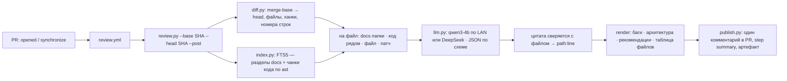

# day32 — AI-ревью pull request: GitHub Action, diff, RAG по документации и коду, замечания с цитатами

Установка и общие команды запуска — в [корневом README](../README.md). Веба нет и терминала как такового тоже: главный способ запуска — workflow [`.github/workflows/review.yml`](../.github/workflows/review.yml) на событие `pull_request`, а тот же скрипт из терминала нужен, чтобы ревью можно было прогнать до коммита и чтобы снять расшифровки для этого README. Модель та же, что в [day26](../day26/README.md)–[day31](../day31/README.md), — `qwen3-4b` в LM Studio, но LM Studio теперь стоит не на этой машине, а на соседней в локальной сети: `192.168.77.47:1234`. Облачная — DeepSeek, запасной путь.

| Условие задания | Где в коде |
| --- | --- |
| пайплайн запускается на PR | [`review.yml`](../.github/workflows/review.yml): `pull_request` с типами `opened`, `synchronize`, `reopened`; `runs-on` из переменной репозитория — self-hosted раннер в локальной сети или `ubuntu-latest` |
| ассистент получает diff и изменённые файлы | [diff.py](diff.py): `git diff` от merge-base базы и головы PR, разбор на файлы и ханки с номерами строк новой версии, файл после изменения через `git show` |
| RAG: документация + код | [index.py](index.py): один индекс FTS5 — разделы README/TASK всех дней и чанки кода по функциям и классам через `ast`; на файл — разделы его папки и функции из других файлов, которые патч зовёт или повторяет |
| потенциальные баги, архитектурные проблемы, рекомендации | [review.py](review.py): JSON по схеме с полем `kind` из трёх значений, markdown с тремя разделами собирает код — они на месте и при нуле замечаний |
| текст ревью | там же `render`, а [publish.py](publish.py) кладёт его комментарием в PR — одним, который обновляется при каждом push |

## Главное решение: пайплайн без инструментов

В day31 модель получала инструменты и могла звать `git_diff` и `docs_search` сама. Для ревью это соблазнительно — «вот репозиторий, вот PR, разбирайся» — и для CI это плохо. [day31](../day31/README.md) показал, что `qwen3-4b` на инструменты не надеется и отвечает без единого вызова; а в CI, где никто не смотрит на ленту вызовов, важнее другое: предсказуемая цена и одинаковый контекст от прогона к прогону. Поэтому пайплайн детерминированный — код сам решает, что модель увидит, и зовёт её по разу на файл плюс один раз на общий вердикт. На PR из десяти файлов это одиннадцать вызовов, всегда.

Что модель видит на каждый файл — четыре блока, в этом порядке:

1. **Документация папки.** Из изменённых строк вынимаются идентификаторы — имена функций, модулей, полей, — и по ним ищутся разделы README/TASK той же папки `dayN`; если в своей папке ничего, то по всей документации. Так ревьюер знает, как день задуман: что ему обещано и почему так.
2. **Код рядом.** По тем же идентификаторам — чанки кода из *других* файлов: функция, которую патч вызывает, модуль, который импортирует, соседний день с тем же решением. Сам файл из выдачи исключён — он идёт следующим блоком целиком.
3. **Файл после изменения** с номерами строк. Целиком, если влезает в бюджет, иначе окнами по ±25 строк вокруг ханков. Новому файлу этот блок не нужен — патч и есть весь файл.
4. **Патч**, где у строк новой версии проставлены номера. Модели так проще назвать строку, чем считать от заголовка `@@`.



Ответ модели — JSON по схеме: `summary` файла и `findings`, у каждого `kind` из трёх значений задания, `severity`, `line`, `quote`, `title`, `detail`, `suggestion`. LM Studio держит модель в рамках схемы грамматикой (`response_format: json_schema`), DeepSeek — режимом `json_object` со схемой в промпте. Markdown из этого собирает код: три раздела по `kind`, внутри — по серьёзности, затем таблица файлов с тем, что каждый делает, и список того, что не ревьюилось и почему — бинарники, lock-файлы, файлы сверх лимита в двадцать.

## Один индекс на документацию и код

Индекс day31 знал только документацию. Здесь корпус — всё, что под git: 69 файлов `.md` и 329 файлов кода — `.py`, `.js`, `.html`, `.css`, `.yml`, — 375 разделов и 4556 чанков в `day32/index.db`. Разбор markdown на разделы импортируется из [day31/docs.py](../day31/docs.py) по пути файла, как day28 брал поиск у day25: он там уже учитывает заголовки внутри блоков кода, и копировать его незачем.

Код режется не окнами, а по структуре. Для `.py` работает `ast`: чанк — это функция, класс или метод с диапазоном строк; класс длиннее 4000 символов распадается на шапку и методы; что между определениями — импорты, константы — чанками «модуль». Так замечание «в day20 эта же функция делает иначе» опирается на целую функцию, а не на её половину. Остальные языки — окнами по 60 строк с перекрытием в 10. Токенайзер FTS5 считает `_` частью слова: запрос к коду идёт идентификаторами, и `stream_chat` должен совпасть целиком, а не по половинкам `stream` и `chat`.

Сборка с нуля — полторы секунды, на раннере это и происходит каждый раз. Локально индекс инкрементальный по sha файла, и при чистом дереве пересчитывать нечего — 70 мс.

## Цитата как якорь

Первый прогон на `qwen3-4b` дал пять замечаний к `agent.py` с одним и тем же текстом на строках 97, 100, 103, 106 и 109: модель, разогнавшись, повторяла одно замечание для соседних строк. Повторы теперь схлопываются по заголовку, но вопрос остался: откуда у замечания номер строки и можно ли ему верить.

Ответ взят у [day24](../day24/README.md): к каждому замечанию модель обязана приложить `quote` — дословный фрагмент строки новой версии, — и код ищет его в файле, пробелы не в счёт. Нашёлся — номер строки берётся из файла, а не из ответа модели (при нескольких совпадениях — ближайшее к названному). Не нашёлся — замечание остаётся, но с пометкой «цитата в файле не найдена», и в подвале ревью стоит счёт: у DeepSeek сошлись 26 цитат из 26, у `qwen3-4b` — 13 из 19. Пометка не говорит, что замечание ложное, но говорит, что модель не смогла показать, о какой строке речь, — и у слабой модели такие замечания в прогоне ниже как раз самые общие: «код не соответствует документации».

## Где крутится: раннер в локальной сети и запасной путь

Раннер GitHub живёт в облаке и до `192.168.77.47` не дотянется. Выбор был из трёх: только self-hosted раннер, только DeepSeek в CI или гибрид. Выбран гибрид, и он весь — в двух местах. Скрипт пробует LM Studio по `LMSTUDIO_BASE_URL` с таймаутом 3 секунды и, если тот молчит или в нём нет нужной модели, уходит в DeepSeek по `DEEPSEEK_API_KEY`; причина печатается первой строкой. Workflow берёт `runs-on` из переменной репозитория `REVIEW_RUNNER`: с `self-hosted` ревью идёт на этом Mac и ходит к LM Studio по LAN, без переменной — на `ubuntu-latest`, где скрипт сам сворачивает в облако.

```
→ модель: deepseek-v4-flash · облачная · DeepSeek — LM Studio http://127.0.0.1:9/v1 не отвечает (APIConnectionError), ревью уходит в облако
```

Репозиторий публичный, и это меняет правила для self-hosted раннера: PR из форка может принести любой код, а workflow выполнит его в локальной сети. Поэтому job идёт только для PR из этого же репозитория — `head.repo.full_name == github.repository`; форки не ревьюятся вовсе, и терять тут нечего — секретов у них всё равно нет. `concurrency` с отменой предыдущего запуска не даёт двум push подряд ревьюить одно и то же.

Поднять раннер — четыре команды, и регистрационный токен для них выдаёт только веб-интерфейс: Settings → Actions → Runners → New self-hosted runner, macOS, ARM64. Страница показывает их с актуальной версией:

```bash
mkdir ~/actions-runner && cd ~/actions-runner
curl -o actions-runner-osx-arm64.tar.gz -L https://github.com/actions/runner/releases/download/v<версия>/actions-runner-osx-arm64-<версия>.tar.gz
tar xzf actions-runner-osx-arm64.tar.gz
./config.sh --url https://github.com/JagArt/ai_advent --token <токен со страницы>
./run.sh                                     # или ./svc.sh install && ./svc.sh start — как сервис
```

После этого — Settings → Secrets and variables → Actions → Variables: `REVIEW_RUNNER = self-hosted`; там же при необходимости `LMSTUDIO_BASE_URL` и `LMSTUDIO_MODEL`, а в Secrets — `DEEPSEEK_API_KEY` для запасного пути. Без раннера нужен только секрет.

## Живой прогон

Ревьюировался коммит day31 — десять файлов, +1906 −2: `python day32/review.py --base HEAD~1 --head HEAD`. Прогресс идёт в stderr, ревью — в stdout.

```
→ модель: qwen3-4b · локальная · LM Studio — LM Studio http://192.168.77.47:1234/v1 на связи · окно 8192 токенов
→ diff: merge-base bf5b78f → HEAD · файлов 10, +1906 −2
→ индекс: документация 69 файлов / 375 разделов, код 329 файлов / 4556 чанков · переиндексировано 3
  [1/10] day31/agent.py …
      замечаний 3 (цитата сошлась у 0) · docs 2 · code 3 · 6.9 с · токены 4101 → 408
  [2/10] day31/assistant.py …
      замечаний 3 (цитата сошлась у 1) · docs 2 · code 3 · 18.6 с · токены 3948 → 642
  [3/10] day31/docs.py …
      замечаний 4 (цитата сошлась у 3) · docs 2 · code 3 · 16.2 с · токены 3770 → 515
  [4/10] day31/llm.py …
      замечаний 5 (цитата сошлась у 5) · docs 2 · code 3 · 19.2 с · токены 3947 → 625
  [5/10] day31/server.py …
      замечаний 3 (цитата сошлась у 3) · docs 2 · code 3 · 17.9 с · токены 4156 → 528
  [6/10] .gitignore …
      замечаний 1 (цитата сошлась у 1) · docs 2 · code 3 · 4.3 с · токены 2784 → 175
  [7/10] day31/requirements.txt …
      замечаний 0 (цитата сошлась у 0) · docs 2 · code 3 · 1.1 с · токены 2121 → 29
  [8/10] README.md …
      замечаний 2 (цитата сошлась у 0) · docs 2 · code 3 · 25.3 с · токены 6015 → 636
  [9/10] day31/README.md …
      замечаний 2 (цитата сошлась у 0) · docs 2 · code 3 · 20.2 с · токены 4207 → 568
  [10/10] day31/TASK.md …
      замечаний 5 (цитата сошлась у 0) · docs 2 · code 3 · 10.8 с · токены 2306 → 465
→ вердикт: модель · всего вызовов 11
```

Начало ревью — то, что уходит в комментарий PR:

```
## AI-ревью · qwen3-4b

`HEAD~1` (merge-base `bf5b78f`) → `HEAD` · файлов 10, +1906 −2 · замечаний 28

**Вердикт.** PR вносит значительные изменения в архитектуру и логику проекта, но содержит серьезные
проблемы с соответствием ожидаемой структуре, ошибки в реализации и повторениями. Риск негативного
влияния на стабильность системы высокий. PR не готов к слиянию из-за критических недочетов.

### Потенциальные баги (3)

- 🔴 `day31/agent.py:100` — **Некорректное поведение модели**. Модель не использует инструменты в случае,
  когда контекст недостаточен → Обновить логику вызова инструментов … <sub>цитата в файле не найдена</sub>
- 🔴 `day31/assistant.py:101` — **Ошибка в обработке состояния**. В строке 105 есть ошибка в обработке
  состояния, где используется несуществующая переменная 'head' → Исправить …
- 🔴 `day31/docs.py:13` — **Неправильная обработка заголовков внутри кода**. В документации говорится, что
  заголовки внутри блоков кода не учитываются, но в коде не проверяется наличие блока кода перед заголовком. → …

### Архитектурные проблемы (21)
…
<sub>qwen3-4b · локальная · LM Studio — … · вызовов 11 · 145 с · токены 37355 → 4591 · цитат подтверждено 13 из 19 · индекс: документация 69 файлов, код 329 файлов</sub>
```

Тот же коммит с `--cloud`:

```
→ модель: deepseek-v4-flash · облачная · DeepSeek — флаг --cloud
  [1/10] day31/agent.py …
      замечаний 5 (цитата сошлась у 5) · docs 3 · code 4 · 6.5 с · токены 7502 → 1004
  …
  [4/10] day31/llm.py …
      ✗ deepseek-v4-flash и после повтора не вернула JSON: Expecting property name enclosed in double quotes: line 1 column 356 (char 355). Начало ответа: '{"summary": "Новый модуль day31/llm.py: …
  …
→ вердикт: модель · всего вызовов 11

### Потенциальные баги (12)

- 🟡 `day31/assistant.py:234` — **IndexError при пустом command.question в ветке other**. … `command.question.split()[0]` без проверки. → Использовать `command.question.split()[0] if command.question else ""` …
- 🟡 `day31/docs.py:108` — **Незакрытый fence глушит все заголовки до конца файла**. Если в документе есть незакрытый блок ``` (или ~~~), fence остаётся непустым до конца файла, и все последующие заголовки перестают распознаваться … → Сбрасывать fence при достижении конца файла …
- 🟡 `day31/server.py:152` — **Распаковка counts без проверки длины**. Если git вернёт не две строки … `int(counts[0]), int(counts[1])` бросит IndexError или ValueError, и инструмент упадёт не через ToolError, а сырым исключением … → Проверить `len(counts) == 2` …
- 🟡 `day31/README.md:9` — **Числа 63/369 расходятся с прогоном в этом же README**. В таблице условий заявлено «63 файла, 369 разделов», а в разделе «Живой прогон» тот же индекс показан как «61, разделов: 357» … → Привести числа к одному значению …
- 🟢 `day31/server.py:165` — **Путь с пробелом в porcelain разбирается неверно**. В `--porcelain=v1` при наличии пробелов в имени файла git берёт путь в кавычки … → Использовать `-z` и разбирать по NUL …
…
<sub>deepseek-v4-flash · облачная · DeepSeek — флаг --cloud · вызовов 11 · 56 с · токены 64397 → 6066 · цитат подтверждено 26 из 26 · …</sub>
```

Файл `llm.py` в этом прогоне остался без ревью: модель дважды вернула JSON с незакрытой кавычкой, и в таблице файлов он помечен `✗` с причиной — пайплайн не падает из-за одного файла. Сообщение об ошибке теперь показывает место разрыва, а повторный запрос просит экранировать кавычки внутри строк; в двух следующих прогонах тот же файл прошёл с первого раза.

## Где локальная модель останавливается

Два ревью одного коммита расходятся не числом замечаний — 28 против 26, — а их природой. У DeepSeek двенадцать багов, и большинство из них проверяется глазами за минуту: `IndexError` на пустой команде, распаковка `counts` без проверки длины, незакрытое ограждение кода в разборе markdown, расходящиеся числа в README. У `qwen3-4b` три бага и двадцать одна «архитектурная проблема», и почти все они — вариации «код не соответствует документации», причём на вопрос «где именно» модель не отвечает: цитаты у этих замечаний либо нет, либо она в файле не находится. И серьёзность она ставит щедро: пятнадцать 🔴 из двадцати восьми, тогда как DeepSeek не поставила ни одного — десять 🟡 и шестнадцать 🟢.

Блок документации, который 4B-модели дан как опора, она читает как обвинительное заключение: раз в README написано «описания инструментов укорочены до одной строки», значит, код, в котором эта строка есть, ей «не соответствует». Это та же ошибка, что в day31, где описание сбоя из README модель прочла как факт, — только теперь в другую сторону. Правило «если код совпадает с документацией — это не замечание» в промпте стоит; на 4B оно работает частично — повторов и общих советов стало меньше, чем в первом прогоне, но не ноль.

Сильная модель ошибается иначе. Замечание «бюджет выдержек не уменьшается по мере расхода» к `agent.py:286` DeepSeek поставила в четырёх прогонах из пяти — а строкой ниже в том же патче стоит `budget -= len(body)`. Цитата у замечания сошлась: модель верно указала строку и неверно её прочла. Сверка цитаты ловит «не о той строке», но не «не так понял» — границу эту знал и day24.

И одна оговорка про контекст. Индекс строится по рабочему дереву, и когда ревьюируется старый коммит, в «коде рядом» оказываются файлы, которых в тот момент не было: DeepSeek в одном из замечаний сравнила `day31/llm.py` с `day32/llm.py` и запуталась, какой из них копия какого. В CI этого нет — там дерево и есть голова PR; локально это цена одного индекса на всё.

## Цена

Локально десять файлов стоят 145 секунд и 37 тысяч токенов промпта; у `qwen3-4b` окно 8192 токена, поэтому бюджеты жёсткие — патч до 5000 символов, файл до 4500, два раздела документации по 900, три чанка кода по 800, — и на файл уходит 2–6 тысяч токенов. Почти всё время — чтение промпта: от секунды на `requirements.txt` до 25 на корневой README. В облаке те же десять файлов — 56 секунд и 64 тысячи токенов: бюджеты втрое шире, а первый токен приходит через секунды. Это тот же вывод, что в day28 и day31: локальная модель платит временем — и здесь ещё качеством разбора.

Публикация — один комментарий на PR. [publish.py](publish.py) ищет среди комментариев свой по HTML-маркеру `<!-- ai-review -->` и обновляет его, а не добавляет новый: иначе каждый push превращал бы PR в ленту ревью. Без токена — вне workflow — публикация отказывает с причиной, а ревью к тому моменту уже напечатано и записано в `review.md`.

## Как устроено

| Файл | Назначение |
| --- | --- |
| `day32/review.py` | Пайплайн и CLI: маршрут, diff, индекс, контекст на файл, промпт и схема, сверка цитат, вердикт, markdown, step summary, публикация |
| `day32/diff.py` | `git diff` от merge-base, разбор на файлы и ханки с номерами строк новой версии, файл после изменения, фильтры и лимиты |
| `day32/index.py` | Корпус и FTS5-индекс документации и кода: разделы markdown сплиттером day31, чанки `.py` через `ast`, окна для остального; идентификаторы из патча как запрос |
| `day32/llm.py` | LM Studio по LAN и DeepSeek за одним вызовом с JSON-ответом, опрос доступности, маршрут по доступности и флагам, повтор при невалидном JSON |
| `day32/publish.py` | Комментарий в PR через REST GitHub: поиск своего по маркеру, обновление или создание |
| `.github/workflows/review.yml` | Событие PR, `runs-on` из переменной с фолбэком, фильтр форков, отмена предыдущего запуска, артефакт с `review.md` и `review.json` |

## Настройка

```
LMSTUDIO_BASE_URL=http://192.168.77.47:1234/v1   # LM Studio на соседней машине; по умолчанию именно он
LMSTUDIO_MODEL=qwen3-4b
DEEPSEEK_API_KEY=sk-…                            # запасной путь; в Actions — секрет
DEEPSEEK_MODEL=deepseek-v4-flash
```

В Actions то же задаётся переменными репозитория `LMSTUDIO_BASE_URL`, `LMSTUDIO_MODEL`, `REVIEW_RUNNER` и секретом `DEEPSEEK_API_KEY`. Бюджеты — в [review.py](review.py): `PATCH_CHARS`, `FILE_CHARS`, `DOCS_*`, `CODE_*` по провайдеру; лимит файлов на ревью — флаг `--max-files`, по умолчанию 20.
