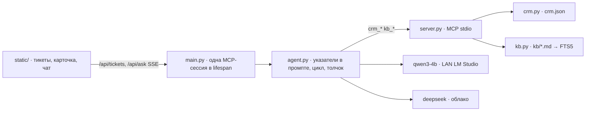

# day33 — ассистент поддержки: RAG по FAQ, CRM через MCP, чистый агент с толчком

Установка и общие команды запуска — в [корневом README](../README.md). Веб на FastAPI, как в [day28](../day28/README.md): слева очередь тикетов, в центре карточка пользователя и обращения, справа чат. Модель та же, что в [day32](../day32/README.md), — `qwen3-4b` в LM Studio на соседней машине в сети, `192.168.77.47:1234`; облачная — DeepSeek, переключателем на странице. Без ключа работает только локальная, без LM Studio — только облако.

Продукт вымышленный: «Планёрка», таск-трекер для команд. База знаний — 18 статей FAQ, CRM — JSON с десятью пользователями и пятнадцатью тикетами. Один и тот же вопрос «Почему не работает авторизация?» на четырёх открытых тикетах имеет четыре разные причины — они лежат в карточке пользователя, а не в формулировке жалобы.

| Условие задания | Где в коде |
| --- | --- |
| отвечает на вопросы о продукте | [agent.py](agent.py): оператор пишет в чат, модель отвечает по базе знаний со ссылками `[n]` |
| RAG: FAQ и документация | [kb.py](kb.py): 18 статей `kb/*.md`, 87 разделов в FTS5 `kb.db`; [server.py](server.py) отдаёт `kb_search` и `kb_read` |
| контекст пользователя или тикета | CRM [crm.json](crm.json) через `crm_get_ticket` и `crm_get_user`; в промпт код кладёт только идентификаторы |
| MCP: CRM или JSON | [server.py](server.py): шесть инструментов над `crm.json` и базой знаний, stdio, как в [day31](../day31/README.md) |
| «Почему не работает авторизация?» с учётом тикета | четыре открытых тикета с одной жалобой и разными полями карточки — блокировка, неподтверждённая почта, SSO чужого домена, приложение 2.9 |

## Главное решение: чистый агент, не гибрид day31

В [day31](../day31/README.md) код до первого токена сам звал `git_branch`, `git_status` и `docs_search` и клал результат в промпт. Без этой подстраховки `qwen3-4b` регулярно отвечала, не позвав ничего. Здесь подстраховки нет сознательно: интересно, ответит ли ассистент поддержки *этого* пользователя, а не «вообще про авторизацию», и в ленте должно быть видно, откуда он это знает.

Системное сообщение несёт роль и указатели: «открыт тикет T-1007 пользователя u-03; их содержимое ты не знаешь — возьми `crm_get_ticket` и `crm_get_user`; о продукте — только `kb_search`». Дальше модель решает сама.

Если первый раунд кончился без единого вызова, ответ отбрасывается, в диалог добавляется толчок — «ты не открыл тикет и не искал в базе знаний» — и даётся ещё раунд. Событие `nudge` видно в ленте, флаг `nudged` — в итоге. На живых вопросах этого дня 4B-модель инструменты звала сама, и толчок не срабатывал; путь проверен моком: первый раунд без вызовов → толчок → `crm_get_ticket` → ответ по данным.



## Живой прогон: один вопрос, четыре причины

Вопрос везде один: «Почему не работает авторизация?». Модель — `deepseek-v4-flash`, тёплая, MCP-сессия одна.

**T-1004**, Анна Коваль, статус `blocked`, 6 неудачных входов:

```
  ⚙ r1 crm_get_ticket(ticket_id='T-1004')
  ⚙ r1 crm_get_user(user='u-01')
  ⚙ r2 kb_search(query='блокировка неудачных попыток входа')

Авторизация не работает из-за блокировки входа после серии неудачных попыток:
в карточке пользователя статус аккаунта «заблокирован», счётчик неудачных
входов 6, блокировка действует до 2026-10-16T09:52:00+03:00 [4]. Форма входа
при этом продолжает показывать «Неверная почта или пароль» [2].
— deepseek-v4-flash · раундов 3 · вызовов 3 · 5.7 с
```

**T-1007**, Мария Сафонова, почта `gmail.com`, команда с SSO `litera.studio` и «только SSO»:

```
  ⚙ r1 crm_get_ticket(ticket_id='T-1007')
  ⚙ r1 crm_get_user(user='u-03')
  ⚙ r2 kb_search(query='домен не разрешён SSO только SSO вход')
  ⚙ r2 crm_search_tickets(query='домен не разрешён для этой команды SSO', exclude='T-1007')

Причина в том, что почта пользователя — m.safonova@gmail.com, а команда
«Студия Литера» требует SSO по домену litera.studio и включён режим
«Только SSO» [2]. Пароль здесь не поможет. По этому же вопросу уже было
обращение T-1015.
— deepseek-v4-flash · раундов 3 · вызовов 4 · 6.0 с
```

**T-1005**, Пётр Ильин, статус `unconfirmed`, зарегистрирован 13 октября:

```
  ⚙ r1 crm_get_ticket · ⚙ r1 crm_get_user
  ⚙ r2 kb_search(query='почта не подтверждена вход в приложение')

Причина в том, что почта аккаунта не подтверждена: статус «почта не
подтверждена» [1]. Блокировку исключаем: счётчик входов 0. Версия
приложения 3.4.1 и 2FA здесь ни при чём.
— deepseek-v4-flash · раундов 3 · вызовов 3 · 5.0 с
```

**T-1009**, Дмитрий Орлов, Android-приложение 2.9.4, в вебе входит:

```
  ⚙ r1 crm_get_ticket · ⚙ r1 crm_get_user
  ⚙ r2 kb_search(query='устаревшая версия приложения Android не удалось войти')

Причина в версии приложения: 2.9.4, а с 1 сентября 2026 года серверы
принимают только протокол из версии 3.0 [1]. Пароль, 2FA и блокировки
тут ни при чём. На компьютере с теми же данными заходит — это совпадает.
— deepseek-v4-flash · раундов 3 · вызовов 4 · 4.9 с
```

Четыре ответа на одну фразу, и ни один не списан с соседнего. Это и есть «учитывать контекст тикета».

## Где останавливается локальная модель

На T-1004 и T-1007 `qwen3-4b` на соседней машине зовёт те же три инструмента и называет ту же причину, короче и без совета оператору:

```
  ⚙ r1 crm_get_ticket(ticket_id='T-1004')
  ⚙ r1 crm_get_user(user='u-01')
  ⚙ r2 kb_search(query='блокировка неудачных попыток')

Пользователь Анна Коваль заблокирован из-за 6 неудачных попыток входа [3].
Блокировка действует до 2026-10-16T09:52:00+03:00 [4].
— qwen3-4b · раундов 3 · вызовов 3 · 7.7 с
```

На T-1009 она ломается. Карточка говорит `app_version: 2.9.4`, `failed_logins: 1`, статус активен — облако идёт в статью про мобильное приложение, 4B ищет «авторизация не работает, блокировка» и отвечает, что человек не входит из-за блокировки после неудачных попыток. Счётчик равен 1, блокировки нет, версия приложения в ответ не попадает. Правило «причину подтверждай полем карточки» 4B читает выборочно: слово «авторизация» сильнее числа в `app_version`.

Это та же граница, что в day31: конкретный факт из уже открытой карточки — локальная модель; вопрос, где нужное поле надо *заметить* среди десятка других, — облако.

## Интерфейс

Страница: http://127.0.0.1:8000 после `uvicorn main:app --reload --app-dir day33`. Плашка статуса показывает рукопожатие MCP, шесть инструментов, 18 статей и 15 тикетов, адрес LM Studio в сети и ключ DeepSeek. Оператор выбирает тикет — карточка приезжает через те же `crm_get_ticket` / `crm_get_user`, что зовёт модель. Подсказки «Почему не работает авторизация?», «Составь ответ клиенту», «Были ли похожие обращения?» подставляют вопрос. В ленте хода — каждый вызов `⚙`, зачёркнутый черновик если был толчок, ответ со ссылками, источники, замеры.

История диалога живёт в браузере и уходит с следующим вопросом: только реплики оператора и тексты ответов, без tool-сообщений, до шести ходов.

## Как устроено

| Файл | Назначение |
| --- | --- |
| `day33/main.py` | FastAPI: lifespan с MCP-сессией, `/api/status`, `/api/tickets`, `/api/ask` SSE |
| `day33/agent.py` | Чистый агент: указатели, цикл с инструментами, толчок, сквозная нумерация статей |
| `day33/llm.py` | Два провайдера за одним стримом с `tool_calls`; адрес LM Studio по умолчанию — LAN |
| `day33/server.py` | MCP-сервер «Планёрка support 33.0»: `crm_*`, `kb_*` |
| `day33/crm.py` | Пользователи и тикеты из JSON, поиск похожих в FTS5 в памяти |
| `day33/kb.py` | Корпус `kb/*.md`, разбор на разделы, FTS5 по sha файла |
| `day33/crm.json` | 10 пользователей, 15 тикетов |
| `day33/kb/` | 18 статей FAQ |
| `day33/static/` | Список тикетов, карточка, чат, лента вызовов |

Сервер самостоятелен: `python day33/server.py` поднимает его для любого MCP-клиента.

## Настройка

```
LMSTUDIO_BASE_URL=http://192.168.77.47:1234/v1
LMSTUDIO_MODEL=qwen3-4b
DEEPSEEK_API_KEY=sk-…
DEEPSEEK_MODEL=deepseek-v4-flash
```

По умолчанию локальная модель — не localhost, а соседняя машина, как в day32. `localhost` задаётся переменной. Бюджеты в [agent.py](agent.py): локальной — ответ инструмента до 3500 символов, раздел базы знаний до 900, пять раундов; облачной — 9000, 2500, шесть раундов.
