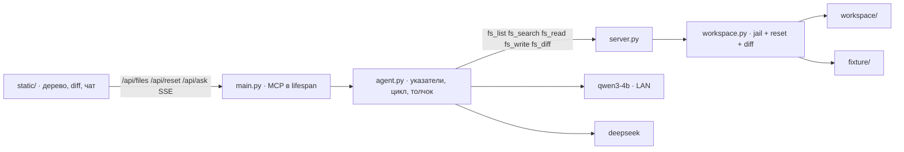

# day34 — файловый ассистент: песочница, MCP, чистый агент с толчком

Установка и общие команды запуска — в [корневом README](../README.md). Веб на FastAPI, как в [day33](../day33/README.md): слева дерево песочницы, в центре превью файла или diff, справа чат. Модель та же — `qwen3-4b` в LM Studio на соседней машине в сети, `192.168.77.47:1234`; облачная — DeepSeek, переключателем на странице. Без ключа работает только локальная, без LM Studio — только облако.

Рабочая копия — только `day34/workspace/`. Эталон мини-проекта `notes` лежит в `fixture/`; кнопка «Сбросить к эталону» копирует его заново. Репозиторий адвента ассистент не трогает.

| Условие задания | Где в коде |
| --- | --- |
| читать, искать, анализировать, создавать и менять файлы | MCP [server.py](server.py): `fs_list`, `fs_search`, `fs_read`, `fs_write`, `fs_diff` над [workspace.py](workspace.py) |
| сам инициирует работу с файлами, цель словами | [agent.py](agent.py): в промпт идут имена файлов, не содержимое; модель сама решает, что открыть |
| найти использования API | пресет 1: поиск `create_note` по `api.py`, `store.py`, `README.md` |
| обновить документацию по коду | тот же пресет пишет раздел API в README: сигнатура `body`, появляется `archive_note` |
| проверить правила и создать файл | пресет 2: сверка с [fixture/RULES.md](fixture/RULES.md), отчёт в `AUDIT.md` |
| изменения сохраняются или как diff | `fs_write` пишет на диск, `Done.diff` — патч относительно эталона; центр страницы рисует его без второго запроса |
| воспроизводится повторно | сброс из fixture → тот же пресет; [scenarios.py](scenarios.py) прогоняет оба |

## Главное решение: песочница и чистый агент

В [day31](../day31/README.md) код до первого токена сам звал git и документацию и клал результат в промпт. В [day32](../day32/README.md) файлы открывал пайплайн, модель только писала ревью. Здесь оба приёма не подходят: задание требует, чтобы ассистент *сам* инициировал работу с файлами по цели, а не по пути.

Системное сообщение несёт указатели, как тикет в day33: «имена сейчас такие-то; содержимое ты не знаешь — возьми `fs_search` и `fs_read`». Если первый раунд кончился без вызовов, ответ отбрасывается, модели даётся толчок.

Писать в живой репозиторий адвента опасно и плохо воспроизводится. Поэтому рабочая копия — копия эталона. В эталоне документация намеренно врёт: `create_note(title, text)`, нет `archive_note`, хотя функция есть в коде и её зовёт `cli.py`. После сброса расхождение возвращается — тот же пресет можно прогнать снова.



## Песочница

Эталон — пакет `notes`:

- `src/notes/api.py` — `create_note(title, body, tags=None)`, `get_note`, `list_notes`, `archive_note`
- `src/notes/store.py` — вызывает `create_note` и `get_note`
- `src/notes/cli.py` — вызывает `list_notes` и `archive_note`
- `README.md` — устарел: `create_note(title, text)`, нет `archive_note`
- `RULES.md` — публичный символ `api.py` должен быть в разделе API у README; у публичных функций есть docstring; `cli` не импортируют другие модули

Все пути резолвятся относительно `workspace/`. `..`, абсолютный путь и запись бинаря — `ToolError`.

## Два сценария

1. «Найди все места, где используется `create_note`, и обнови README так, чтобы раздел API совпадал с кодом».
2. «Проверь проект на правила из RULES.md и запиши отчёт в AUDIT.md».

Успех виден по diff: после первого в README есть `archive_note` и `body`; после второго появляется `AUDIT.md`. Свободный ввод цели тоже работает.

## Живой прогон

Песочница без модели:

```bash
python day34/scenarios.py
```

Ожидается: reset копирует шесть файлов, jail отвергает `..`, поиск `create_note` находит `api.py`, `store.py`, `__init__.py` и README, запись `AUDIT.md` видна в diff, повторный reset стирает правки.

Два пресета — `deepseek-v4-flash`, тёплая MCP-сессия, перед каждым цель `workspace.reset()`.

**Пресет 1.** Найти использования `create_note` и обновить README:

```
  ⚙ r1 fs_search(query='create_note')
  ⚙ r1 fs_read(path='README.md')
  ⚙ r2 fs_read(path='src/notes/api.py')
  ⚙ r2 fs_read(path='src/notes/cli.py')
  ⚙ r3 fs_write(path='README.md', …)
  ⚙ r4 fs_diff(path='README.md')

Использования: README, __init__.py, api.py (определение), store.py (вызов).
README приведён к коду: body вместо text, добавлены tags, include_archived и archive_note.
— deepseek-v4-flash · раундов 5 · вызовов 6 · 9.3 с
```

```diff
-note = create_note("покупка", text="молоко")
+note = create_note("покупка", body="молоко")
- `create_note(title, text)` — создаёт заметку. Второй аргумент называется `text`.
+ `create_note(title, body, tags=None)` — создаёт заметку.
- `list_notes()` — все заметки списком.
+ `list_notes(*, include_archived=False)` — все заметки списком; по умолчанию без архивных.
+ `archive_note(note_id)` — помечает заметку архивной.
```

**Пресет 2.** Проверить RULES.md и записать AUDIT.md (эталон снова устаревший — после сброса):

```
  ⚙ r1 fs_read(path='RULES.md') · ⚙ r1 fs_list()
  ⚙ r2 fs_read(README.md, api.py, cli.py, store.py, __init__.py)
  ⚙ r3 fs_search(query='notes.cli') · ⚙ r3 fs_search(query='import', path='src/notes')
  ⚙ r4 fs_write(path='AUDIT.md', …)

Правило 1 нарушено: archive_note есть в api.py и нет в README.
Правило 2 соблюдено: у всех публичных функций docstring.
Правило 3 соблюдено: notes.cli никто не импортирует.
Сигнатура в README врёт: text вместо body.
— deepseek-v4-flash · раундов 5 · вызовов 10 · 12.5 с
```

Оба прогона трогают больше трёх файлов, пишут на диск и оставляют diff. Повтор: сброс → тот же пресет.

## Интерфейс

Страница: http://127.0.0.1:8000 после `uvicorn main:app --reload --app-dir day34`. Плашка статуса показывает рукопожатие MCP и пять инструментов, адрес LM Studio и ключ DeepSeek. Слева — дерево `workspace/` и кнопка сброса. Центр — выбранный файл или сводный diff после хода. Справа — два пресета, переключатель модели, лента `⚙ fs_search(...)`.

История диалога живёт в браузере и уходит со следующей целью: только формулировки и тексты ответов, без tool-сообщений, до шести ходов.

## Как устроено

| Файл | Назначение |
| --- | --- |
| `day34/main.py` | FastAPI: lifespan с MCP-сессией, `/api/files`, `/api/reset`, `/api/ask` SSE |
| `day34/agent.py` | Чистый агент: указатели, цикл с инструментами, толчок, `Done` с diff |
| `day34/llm.py` | Два провайдера за одним стримом с `tool_calls`; адрес LM Studio по умолчанию — LAN |
| `day34/server.py` | MCP-сервер «notes files 34.0»: `fs_*` |
| `day34/workspace.py` | Jail, reset, дерево, чтение, поиск, запись, unified diff vs fixture |
| `day34/fixture/` | Эталон мини-проекта `notes` |
| `day34/workspace/` | Рабочая копия, не коммитится, создаётся при старте и сбросе |
| `day34/scenarios.py` | Проверки без модели и живой прогон пресетов |
| `day34/static/` | Дерево, превью, diff, чат, лента вызовов |

Сервер самостоятелен: `python day34/server.py` поднимает его для любого MCP-клиента.

## Настройка

```
LMSTUDIO_BASE_URL=http://192.168.77.47:1234/v1
LMSTUDIO_MODEL=qwen3-4b
DEEPSEEK_API_KEY=sk-…
DEEPSEEK_MODEL=deepseek-v4-flash
```

По умолчанию локальная модель — не localhost, а соседняя машина, как в day32–day33. `localhost` задаётся переменной. Бюджеты в [agent.py](agent.py): локальной — ответ инструмента до 3500 символов, пять раундов; облачной — 9000, шесть раундов. Потолок ответа 1800 токенов: в аргументах `fs_write` уезжает файл целиком.
